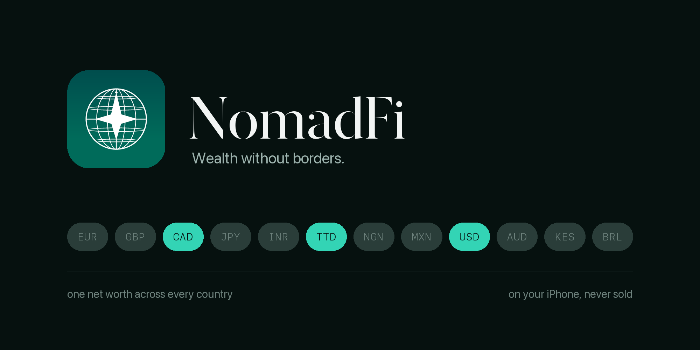
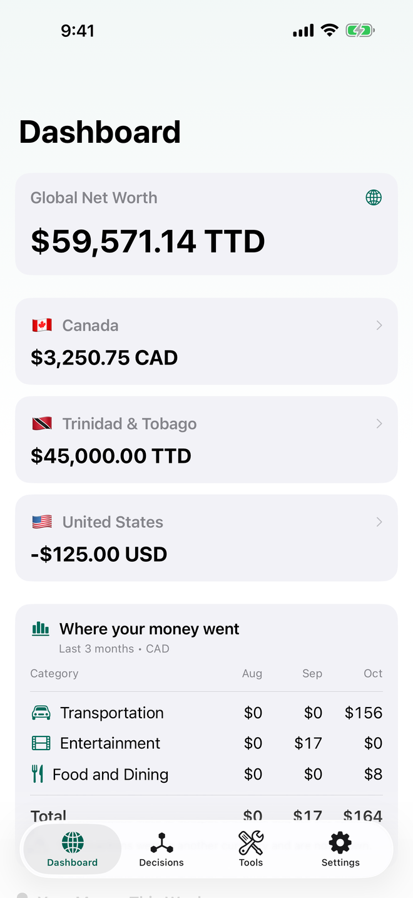
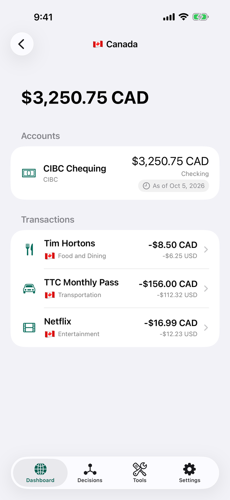
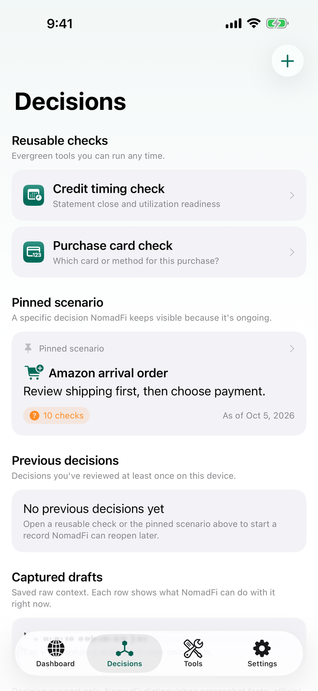
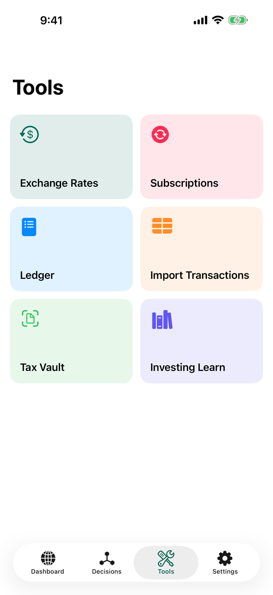
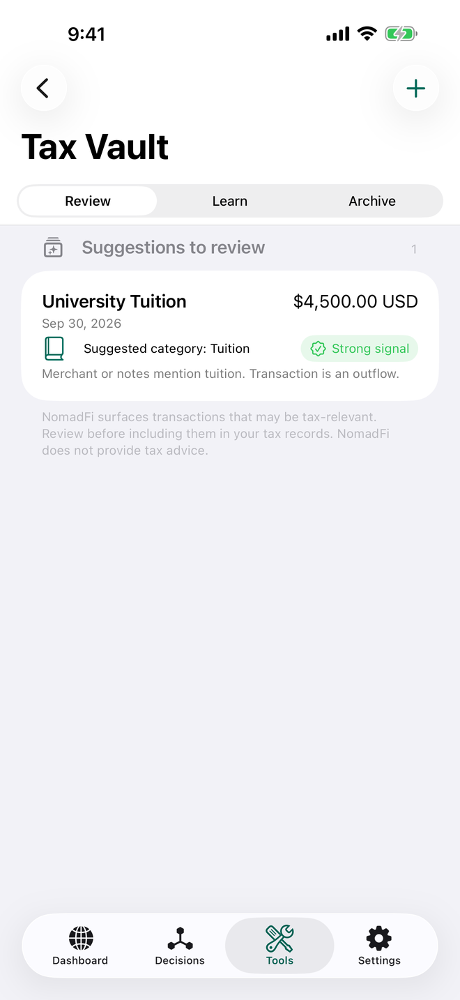
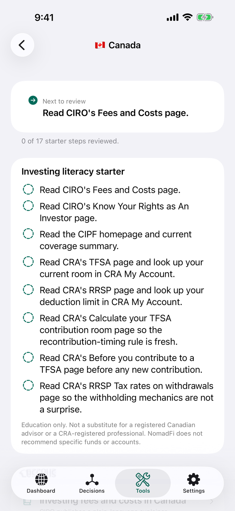

<div align="center">

# NomadFi 💷

<kbd>
    
</kbd>

## Project Description 🎨

"NomadFi" is an iOS app built with SwiftUI that acts as a **Personal CFO for international students** managing money across multiple countries. Instead of juggling separate banking apps across jurisdictions, NomadFi unifies fragmented finances into a single dashboard that surfaces hidden costs, optimizes payment decisions, and automates cross-border tax compliance.

The app applies [Ramp's](https://ramp.com) B2B spend-management logic to the personal B2C context — combining on-device `Foundation Models` for decision intake, `Vision` for receipt OCR, `App Intents` for Siri automation, and `WidgetKit` Control Widgets for one-tap on-device intake from Control Center, the Lock Screen, and the Action button to eliminate the "financial leakage" (hidden FX fees, poor exchange rates, tax confusion) that costs international students real money every day.

Current personal finance apps are domestic-focused. They break when you add a Trinidadian bank account, a Canadian credit card, and a US J-1 salary. **NomadFi doesn't.**


## Highlights 💫
<div align="left">

### The Universal Ledger 🌍
- **Global Net Worth dashboard** aggregates accounts across jurisdictions (TTD, CAD, USD) using real-time mid-market exchange rates — so you always know exactly how rich you are in your home currency vs. your spending currency.
- **Manual entry and CSV import** support any international bank today. **FinanceKit** support is built and waits on Apple making the entitlement available in NomadFi's region.

### Arbitrage Intelligence 💡
- **"Active Card" engine** uses `CoreLocation` to detect your current country and recommends the optimal payment source — eliminating hidden FX fees before you tap.
- **"Real Cost" calculator** reveals the true home-currency cost of every transaction, exposing the gap between what you paid and the mid-market fair rate.

### The Tax Vault 🗄️
- **Receipt scanner** powered by the `Vision` framework extracts merchant names, amounts, and dates from a photo of a receipt using on-device text recognition.
- **Auto-categorization** tags documents by jurisdiction and tax category (Treaty Benefits, Education Expenses, J-1 Wages), then exports organized reports at tax season.

### Subscription Arbitrage 💰
- **Cross-border price comparison** detects recurring subscriptions and checks pricing across the user's jurisdictions — surfacing savings like "Keep your Canadian Netflix; it's 20% cheaper than switching to US pricing."

### Portfolio Lab 📈
- **FX-aware portfolio optimizer** treats the cost of converting money (bank spread, brokerage auto-conversion, Norbert's Gambit) as a trading cost, so you can see how an expensive conversion changes the best mix of funds and what it would have cost over time.
- **Research-to-production pipeline**: a PySpark job (runnable locally, on Databricks or with S3) publishes Bank of Canada month-end FX rates, and the on-device Swift engine is checked against an independent Python reference with parity tests. Real fund prices come from Tiingo using your own token, so licensed data never passes through NomadFi. See [Portfolio Lab](docs/PortfolioLab.md).

### Siri & System Integration 🗣️
- **App Intents** enable voice-first interactions: *"Hey Siri, I just spent $15 USD on lunch"* logs a transaction; *"Which card should I use?"* returns a location-aware recommendation.
- **WidgetKit** brings global net worth to the Home Screen and a one-tap **Control Widget** that puts NomadFi's on-device Apple Intelligence intake on Control Center, the Lock Screen, and the Action button.

### Production Hardening & Accessibility 🦾
- **Accessibility-first design** ensures full VoiceOver narratives, Dynamic Type at every scale (including AX5), and complete support for Reduce Motion, Reduce Transparency, and Differentiate Without Color.
- **Privacy-first architecture** keeps all financial data on-device — nothing leaves the iPhone unless the user explicitly exports.

</div>

## Screenshots

<div style="display: flex; justify-content: center; align-items: center;">
    <kbd>
        
    </kbd>
    <kbd>
        
    </kbd>
    <kbd>
        
    </kbd>
</div>

<div style="display: flex; justify-content: center; align-items: center;">
    <kbd>
        
    </kbd>
    <kbd>
        
    </kbd>
    <kbd>
        
    </kbd>
</div>

## Technologies Used 💻

This project uses modern Swift, SwiftUI, and Apple platform frameworks for a native, privacy-first cross-border finance experience.

- [x] Swift 6 language mode with complete strict concurrency (`async/await`, actors, `Sendable`)
- [x] SwiftUI with the Observation framework
- [x] SwiftData
- [x] Foundation Models (on-device Apple Intelligence decision intake)
- [x] App Intents + App Shortcuts (Siri and Spotlight)
- [x] WidgetKit (Home Screen and Lock Screen widgets, Control Center controls)
- [x] Vision (on-device receipt text recognition) and PhotosUI
- [x] CoreLocation and MapKit (current-country detection)
- [x] Keychain Services and Complete Data Protection (app locking is left to iOS's Require Face ID)
- [x] Core Spotlight
- [x] TipKit
- [x] UserNotifications
- [x] FinanceKit (built in; awaiting regional availability)
- [x] OSLog (structured logging)
- [x] Swift Charts (Portfolio Lab history, with a month-by-month table for VoiceOver)
- [x] Python, NumPy and SciPy (Portfolio Lab research reference and parity fixtures)
- [x] Apache Spark (PySpark) with a Databricks asset bundle (Bank of Canada FX pipeline)
- [x] Swift Testing and XCTest UI testing

## Skills Demonstrated 🥋

This project is designed to showcase distinguished-level iOS engineering practices:

- [x] **SYSTEM DESIGN**: Privacy-first, on-device architecture with graceful degradation across FinanceKit availability, network conditions, and jurisdiction coverage.
- [x] **CROSS-BORDER DATA MODELING**: SwiftData schema that natively represents multi-currency transactions, jurisdiction-aware accounts, and real-time FX rate snapshots.
- [x] **PLATFORM INTEGRATION**: Deep integration with App Intents, WidgetKit (including Control Widgets), Foundation Models, Vision, CoreLocation, and FinanceKit for a system-native experience.
- [x] **SOCIAL IMPACT**: Purpose-built tooling that addresses a real affordability crisis — making hidden FX fees visible and cross-border tax compliance manageable for a vulnerable population.
- [x] **ACCESSIBILITY EXCELLENCE**: VoiceOver narratives, Dynamic Type at AX5, Reduce Motion/Transparency support, and WCAG 2.1 AA contrast compliance on every screen.
- [x] **TESTABILITY**: Protocol-oriented service layer with mock implementations from Day 1, enabling comprehensive unit testing and SwiftUI Previews.

## Contributing ⚙️

Contributions are welcome. If you have ideas for features, architecture improvements, or bug fixes, open an issue or submit a pull request. Please keep changes aligned with the project's privacy-first, accessibility-first, and on-device-first design principles.

### Git Hook Setup

Install Python 3 and Gitleaks 8.30.0 or newer, then enable the local checks:

```bash
brew install gitleaks
bash scripts/install-hooks.sh
```

The pre-commit hook blocks detected credentials, likely card numbers, labeled
sensitive identifiers, and private files in staged changes. It also strips
generated localization comments without staging unrelated edits. Missing
scanner dependencies block commits. See [commit security checks](docs/CommitSecurity.md)
for coverage, limitations, and resolving false positives.

## License 🪪

Released under the **MIT License** — free to use, copy, modify, merge, publish, distribute, sublicense, and sell, for private or commercial purposes, provided the original copyright notice and permission notice are retained. Offered without warranty of any kind. See [LICENSE](LICENSE) for the full text.

</div>
