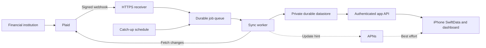

# Plaid Hosted Connection and Automatic Sync Plan

Updated: October 5, 2026. Status: **planned; no hosted deployment yet**.

This is the implementation plan for Phase 5E and the minimum Phase 5F
hardening needed for an owner-only hosted pilot. The
[product timeline](./TIMELINE.md#phase-5--financial-data-access-and-open-finance-strategy)
tracks its milestones. Architecture choices below are engineering proposals;
provider behavior is linked to official documentation.

## Outcome and scope

NomadFi maintains authorized bank connections without a running Mac or a
hotspot. A hosted service receives Plaid updates and persists changes while
the phone is offline. The iPhone automatically catches up and feeds the same
SwiftData accounts, transactions, dashboard, and decision engines used today.

Start with the owner's already-tested Canadian connection and Transactions
product. Support multiple connections in the data model, but keep onboarding
restricted to the owner until a separate release decision. Manual entry and
CSV import continue to work offline. Payments, trading, investment feeds,
additional aggregators, and broader institution-coverage claims are outside
this plan.

“Persistent” means surviving backend restarts and app inactivity. It does
not mean authorization lasts forever or that every transaction appears
instantly. Bank refresh timing and occasional user reauthentication remain
external constraints.

## Verified starting point

- Live Canadian Link/MFA, public-token exchange, account import, and repeated
  explicit sync succeeded on a physical device.
- Interrupted-Link recovery is committed in `93d2804`.
- Country assignment now backfills previously unclassified imports from the
  same provider, preserving existing classifications and snapshot provenance:
  `75aa27e`; 24 focused tests passed.
- Sample accounts, their transactions, and sample-derived subscriptions were
  removed after explicit confirmation and a private backup. Readback verified
  that real transaction rows and account identities/balances were preserved,
  no duplicate transaction IDs remained, and a further sync did not restore
  sample data. The dashboard reflects real imported balances.
- Explicit account and subscription deletion controls with confirmation are
  committed in `06d5c88`; the signed device build and actual deletion flows
  passed. Both scoped commits passed the staged security scanner.
- Institution names, personal balances, identifiers, exact live-record counts,
  database backups, and validation exports remain in ignored private evidence.

These checks establish session connectivity and cleanup correctness. They do
not establish complete agreement with bank statements, sustained reliability,
or readiness for public onboarding. Bank-record comparison and the original
validation-artifact review remain release gates.

## Current gaps in the code

| Area | Current behavior | Required change |
| --- | --- | --- |
| Broker | `tools/plaid-sandbox-broker/server.js` holds tokens in a `Map` | Durable, encrypted per-user connection storage |
| Authentication | Development shared secret and a fixed evaluation user | Verified user identity and ownership checks on every app endpoint |
| Sync ownership | iPhone configuration stores the Plaid cursor | Backend owns the Plaid cursor; each device has a separate delivery checkpoint |
| Updates | Explicit Sync Now; no hosted webhook worker | Verified webhooks, durable jobs, retries, and scheduled catch-up |
| Reconciliation | Adapter collects `removed` IDs but does not deliver them to local reconciliation | Apply removals and pending-to-posted replacements without duplication |
| Pagination | Adapter caps pages without rejecting an unfinished pass | Never publish an incomplete pass or advance past unapplied data |
| Lifecycle | Developer connection setup and session recovery | Production connection states, update-mode repair, and disconnect |
| Privacy | Product copy describes on-device storage | Accurate hosted-processing disclosures before cloud data collection |

Relevant iOS files are under
`NomadFi/NomadFi/Core/Services/FinancialData/Providers/Plaid/`, especially
`PlaidSandboxConfiguration.swift` and `PlaidSandboxFinancialDataProvider.swift`.
Preserve provider-neutral models and reconciliation boundaries.

## Proposed hosting architecture

Use one Google Cloud project for the pilot, with a separate sandbox/staging
environment. Deployment is gated on the owner's cloud account, billing,
region, and data-processing choices; no paid resources are provisioned by
this documentation change.

| Component | Proposed service | Responsibility |
| --- | --- | --- |
| API and webhook receiver | Cloud Run, Node.js | Stable HTTPS API; adapt existing broker logic |
| Durable state | Firestore, backend access only for financial records | Connections, account snapshots, transactions, jobs, sync generations, deletion markers |
| App identity | Firebase Authentication, initially Sign in with Apple | Stable user ID; backend verifies tokens and enforces ownership |
| Secrets | Secret Manager and Cloud KMS | App-level Plaid secret and encryption keys; encrypted bank access tokens in the datastore |
| Background work | Cloud Tasks and a Cloud Run worker | Durable retryable jobs, bounded concurrency, per-connection serialization |
| Recovery schedule | Cloud Scheduler | Enqueue catch-up work for stale connections |
| Device hints | APNs | Content-free “updates available” hints; foreground catch-up remains authoritative |

Cloud Run provides a managed HTTPS endpoint and disposable instances, so
persistence must be external to its process/filesystem.
[Cloud Run overview](https://docs.cloud.google.com/run/docs/overview/what-is-cloud-run).
The backend validates the authenticated user rather than trusting a user ID
or connection ID supplied by the phone.
[Firebase token verification](https://firebase.google.com/docs/auth/admin/verify-id-tokens).

Keep the current local broker as a development harness while introducing a
deployable service under `services/plaid-backend/` and deployment configuration
under `infra/plaid/` (proposed paths). Share tested mapping/protocol code where
useful; do not expose the harness unchanged to the public internet.

## Sync and data contracts

1. **Connect.** Authenticate the owner, create a Link token using that user's
   stable ID, exchange the public token on the backend, and persist encrypted
   access credentials and connection ownership. Register the webhook URL and
   initialize Transactions sync. Persist exchange request/recovery state;
   never log raw tokens. A crash between Plaid exchange and durable storage
   must produce an explicit recovery path rather than a false success.
2. **Receive.** Verify the Plaid webhook signature, timestamp, and raw-body
   hash. Durably enqueue/coalesce work before acknowledging the notification.
   Reject invalid messages; tolerate duplicate and out-of-order delivery.
   [Webhook verification](https://plaid.com/docs/api/webhooks/webhook-verification/).
3. **Fetch.** Serialize jobs per connection using a lease with expiry and a
   generation/fencing check. Start at its committed Plaid cursor and consume
   every page. Retry a mutation-during-pagination error from the cursor at
   the beginning of that pass. Rate-limit and back off transient failures.
4. **Commit.** Apply additions, modifications, and removal markers by durable
   provider identity. Stage large passes in bounded writes, then atomically
   publish a completed generation and its cursor. Do not assume an arbitrary
   history fits in one Firestore transaction. Crashes or page limits leave
   the last completed generation readable and replayable.
5. **Deliver.** Expose owner-scoped account snapshots and transaction changes
   using a NomadFi delivery cursor distinct from Plaid's upstream cursor.
   Each device advances its checkpoint only after a successful SwiftData
   save. Include removals, stable IDs, freshness, and connection status.
   Keep manual fields, country assignments, annotations, and receipt data
   separate from provider-owned fields. Preserve user-authored receipt/tax
   artifacts when an upstream transaction disappears; do not blindly invoke
   the existing transaction-to-document cascade.
6. **Recover.** Retry queued work and periodically inspect stale connections.
   Initial proposal: an hourly stale-connection sweep, with bounded fetches
   and configurable rate limits. This fetches available Plaid updates; it
   does not force a new bank refresh. A returning device can bootstrap from
   a full completed snapshot if its delivery cursor has expired.

Plaid's `SYNC_UPDATES_AVAILABLE` webhook signals when transaction changes can
be retrieved; the initial `/transactions/sync` call activates that flow.
[Transaction webhooks](https://plaid.com/docs/transactions/webhooks/),
[Transactions API](https://plaid.com/docs/api/products/transactions/).

Keep balances separate from transaction arithmetic. Record when a balance
was fetched, any provider-supplied observation time, and whether it is cached.
Do not label a newly fetched cached balance as a fresh bank observation.
Initially use cached account balances; decide separately whether Balance or
Transactions Refresh access and charges justify forced refresh controls.
[Balance documentation](https://plaid.com/docs/balance/).

## iPhone behavior and connection lifecycle

- Automatically fetch backend changes on sign-in, app foreground, and a
  coalesced refresh while active. Keep explicit Sync Now as a useful fallback.
- Request background refresh and use silent pushes as best-effort hints;
  never rely on iOS waking up to maintain the upstream connection.
  [Apple background updates](https://developer.apple.com/documentation/usernotifications/pushing-background-updates-to-your-app).
- Show last successful sync, balance freshness, syncing, delayed, reconnect
  required, and disconnected states. Keep the last valid data visible with
  its timestamp during an outage.
- Handle `ITEM_LOGIN_REQUIRED`, expiring consent, and revoked access. Use
  Plaid Link update mode to repair an existing connection, then resume sync.
  Do not ask for new credentials inside NomadFi's own UI.
  [Plaid update mode](https://plaid.com/docs/link/update-mode/).
- Separate hiding/removing local data from disconnecting the provider. A
  disconnect revokes the Plaid Item, disables queued jobs, and follows an
  explicit retained-history policy. Account deletion and user deletion must
  cover the hosted store, backups/retention, devices, and revocation retries.
- On sign-out/account change, prevent one user's cached data from appearing
  in another session. No public enrollment during the owner-only pilot.

## Milestones and exit criteria

All hosted milestones are planned. Complete them in dependency order;
calendar dates are assigned after cloud access and plan terms are known.

### H0 — Rollout decisions and acceptance baseline

- [ ] Review the remaining private reconciliation artifact and compare live
  imports against bank records, including covered dates and pending entries.
- [ ] Verify the actual Plaid plan, Transactions permissions, Item allowance,
  refresh-product access, and applicable charges in the Dashboard. Production
  credentials alone do not establish plan terms or broad coverage.
- [ ] Select cloud project, deployment/database region, billing budget,
  backup retention, and access roles. Document estimated costs and limits.
- [ ] Update privacy policy, in-app disclosures, and App Store privacy
  information to describe hosted processing before collecting cloud data.

**Exit:** owner-only scope, data handling, costs, and acceptance evidence are
recorded; implementation may proceed locally while external choices remain
open. Cloud deployment/data transfer waits for those choices.

### H1 — Durable backend and authenticated ownership

- [ ] Create deployable service, environment separation, infrastructure
  configuration, secret injection, and local/emulator development commands.
- [ ] Implement verified sign-in, owner allowlist, user-scoped Link/exchange,
  durable token encryption, ownership checks, and recoverable exchanges.
- [ ] Add least-privilege service identities, backups, rate limits, redacted
  diagnostics, and deployment rollback instructions.

**Exit:** staging survives restart/redeploy; unauthorized and cross-user
requests fail; no Plaid access token reaches the app or logs.

### H2 — Complete transaction reconciliation

- [ ] Implement staged sync generations, durable upstream cursors, leases,
  bounded paging, pending-to-posted transitions, and removals.
- [ ] Add the app delivery API with independent device checkpoints and
  snapshot bootstrap; preserve local-only annotations and documents.
- [ ] Test duplicate jobs, concurrent workers, crashes around cursor commit,
  pagination mutations, deletions, expired checkpoints, and changed balances.

**Exit:** repeated/replayed sync converges to one correct record set; failed
passes cannot skip changes or expose partial history.

### H3 — Automatic jobs and freshness

- [ ] Implement verified webhooks, durable enqueue/acknowledgment, retries,
  dead-letter handling, and scheduled stale-connection catch-up.
- [ ] Update cached account snapshots and separate fetch time from balance
  observation time; enforce cost and rate limits.
- [ ] Measure queue delay, last successful sync, and failure counts without
  financial payloads or credentials in telemetry.

**Exit:** sandbox updates are ingested with the app closed; invalid webhooks
fail; duplicate/delayed events and simulated outages recover correctly.

### H4 — App delivery, reconnect, and disconnect

- [ ] Add authenticated hosted provider configuration and multi-connection
  identity mapping; remove manual broker URL/secret setup from the normal flow.
- [ ] Apply updates/removals and persist device checkpoints only after local
  saves; refresh on foreground and best-effort background opportunities.
- [ ] Add connection-state UI, Link update-mode repair, sign-out isolation,
  disconnect/revocation, and hosted-data deletion behavior.

**Exit:** data updates without Sync Now; offline use remains functional;
reauthentication resumes the existing connection; disconnect stops jobs.

### H5 — Migrate the existing connection and run the pilot

- [ ] Take a private backup and verify a rollback path before switching URLs
  or connection identifiers. Do not stop the local broker merely to deploy.
- [ ] Prefer a controlled transfer of the existing Item only if its token
  can be recovered through an explicitly designed, authenticated migration
  path. The current broker exposes no token-export endpoint; do not assume
  a transfer is already available. Otherwise perform one hosted Link flow.
- [ ] Preserve account mapping and existing history. Re-linking may produce
  new provider IDs; use a reviewed migration map and reconciliation checks,
  not account-name matching alone. Revoke a superseded Item only after the
  new connection is verified, with a stated fallback if rollback then needs Link.
- [ ] Register/update the webhook and bootstrap backend history without
  duplicating or silently dropping existing local records.
- [ ] Validate one full sync with the Mac off and hotspot disabled, then
  reopen the app and compare it with the hosted snapshot and bank records.
- [ ] Observe at least seven days, including backend redeploy/restart,
  phone-offline catch-up, and a real upstream update. Extend observation if
  no update occurs; passing time alone is not evidence of successful sync.

**Exit:** the owner no longer depends on the local broker, all migration
checks pass, and private evidence supports automatic operation.

### H6 — Broader rollout decision

- [ ] Exercise restore, revocation, retention/deletion, access isolation,
  alerting, and failure runbooks under expected load.
- [ ] Review measured cost per connected Item/user and sustained bank
  reliability; agree operational thresholds and support responsibilities.
- [ ] Enable additional users/institutions only after separate readiness and
  plan/coverage review. Retain manual and CSV fallbacks.

**Exit:** explicit release decision supported by operational evidence.

## Release acceptance matrix

| Scenario | Required result |
| --- | --- |
| Mac off; phone closed/offline | Backend ingests available updates independently |
| App returns online | Local store and dashboard converge to the completed backend snapshot |
| Backend redeploy or worker crash | Connection survives; committed cursor cannot skip unapplied changes |
| Duplicate/out-of-order events | No duplicate transactions or regression to older state |
| Modified/removed/pending transaction | Correct replacement/removal; user annotations and documents preserved |
| Invalid webhook or another user's connection ID | Request rejected without data disclosure |
| Bank MFA/consent expiry | Clear reconnect state; update mode restores syncing |
| Disconnect/user deletion | Jobs stop, provider revocation is handled, retention policy is enforced |
| Bank outage or stale balance | Last known data remains visible with accurate freshness/status |
| Migration | Real records and classifications preserved; sample data cannot reappear |

## Cost, privacy, and operating limits

Use minimal Transactions scope for the pilot. Avoid paid refresh loops and
unbounded polling. Track cloud jobs, storage, egress, secrets/key operations,
and Plaid Item/product charges separately. Budget alerts are informational;
use application rate limits and resource caps as additional controls. Exact
pricing and account eligibility require Dashboard verification.
[Plaid billing](https://plaid.com/docs/account/billing/).

Only bank-feed data necessary for this feature belongs in the backend.
Manual records, receipt images, and decision drafts remain local unless a
separate feature explicitly changes that boundary. No credentials, personal
records, production dumps, or live screenshots belong in Git. Keep private
verification artifacts in the existing ignored evidence directory; public
test fixtures remain synthetic. Keep the staged security hooks enabled.

Implementation completion means the acceptance matrix passes, not merely
that a server URL responds. The next engineering slice is **H1 durable
storage and authenticated ownership**, with H0 deployment decisions resolved
before any hosted live-data transfer.
