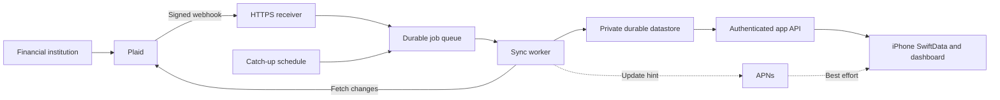

# Plaid Hosted Connection and Automatic Sync Plan

Updated: October 5, 2026. Status: **implementation started locally; no hosted deployment yet**.

This is the implementation plan for Phase 5E and the minimum Phase 5F
hardening needed for an owner-only hosted pilot. The
[product timeline](./TIMELINE.md#phase-5--financial-data-access-and-open-finance-strategy)
tracks its milestones. Architecture choices below are engineering proposals;
provider behavior is linked to official documentation.

## Outcome and scope

NomadFi maintains authorized bank connections without a running Mac or a
hotspot. A hosted service receives Plaid updates and persists changes while
the phone is offline. The iPhone automatically catches up and feeds the same
SwiftData accounts, transactions, dashboard, and decision engines used today.

Start by migrating the already-tested Canadian connection, then validate
Canadian Amex and U.S. Chase through independent connections. Multi-bank
support is required before linking another live institution. Keep onboarding
restricted to the owner until a separate release decision. Transactions is
the initial product; assess Liabilities separately for card-payment details.
Manual entry and CSV import continue to work offline. Payments, trading,
investment feeds,
additional aggregators, and broader institution-coverage claims are outside
this plan.

“Persistent” means surviving backend restarts and app inactivity. It does
not mean authorization lasts forever or that every transaction appears
instantly. Bank refresh timing and occasional user reauthentication remain
external constraints.

## Verified starting point

- Live Canadian Link/MFA, public-token exchange, account import, and repeated
  explicit sync succeeded on a physical device.
- Interrupted-Link recovery is committed in `93d2804`.
- Country assignment now backfills previously unclassified imports from the
  same provider, preserving existing classifications and snapshot provenance:
  `75aa27e`; 24 focused tests passed.
- Sample accounts, their transactions, and sample-derived subscriptions were
  removed after explicit confirmation and a private backup. Readback verified
  that real transaction rows and account identities/balances were preserved,
  no duplicate transaction IDs remained, and a further sync did not restore
  sample data. The dashboard reflects real imported balances.
- Explicit account and subscription deletion controls with confirmation are
  committed in `06d5c88`; the signed device build and actual deletion flows
  passed. Both scoped commits passed the staged security scanner.
- Live institution selections, personal balances, identifiers, live-record counts,
  database backups, and validation exports remain in ignored private evidence.

These checks establish session connectivity and cleanup correctness. They do
not establish complete agreement with bank statements, sustained reliability,
or readiness for public onboarding. Bank-record comparison and the original
validation-artifact review remain release gates.

## Current gaps in the code

| Area | Current behavior | Required change |
| --- | --- | --- |
| Broker | `tools/plaid-sandbox-broker/server.js` holds tokens in a `Map` | Durable, encrypted per-user connection storage |
| Authentication | Development shared secret and a fixed evaluation user | Verified user identity and ownership checks on every app endpoint |
| Connections | Configuration stores one Item ID; a successful new Link replaces it and clears its cursor | Independent connections; adding a bank preserves every existing sync target |
| Sync ownership | iPhone configuration stores one Plaid cursor | Backend owns a cursor per connection; each device has a separate delivery checkpoint |
| Country and OAuth | Local live evaluation is Canada-only; OAuth return plumbing has no live Chase validation | CA/US Link configuration, institution/product access checks, and verified Chase return flow |
| Updates | Explicit Sync Now; no hosted webhook worker | Verified webhooks, durable jobs, retries, and scheduled catch-up |
| Reconciliation | Adapter collects `removed` IDs but does not deliver them to local reconciliation | Apply removals and pending-to-posted replacements without duplication |
| Pagination | Adapter caps pages without rejecting an unfinished pass | Never publish an incomplete pass or advance past unapplied data |
| Lifecycle | Developer connection setup and session recovery | Production connection states, update-mode repair, and disconnect |
| Privacy | Product copy describes on-device storage | Accurate hosted-processing disclosures before cloud data collection |

Relevant iOS files are under
`NomadFi/NomadFi/Core/Services/FinancialData/Providers/Plaid/`, especially
`PlaidSandboxConfiguration.swift` and `PlaidSandboxFinancialDataProvider.swift`.
Preserve provider-neutral models and reconciliation boundaries.

## Multi-bank and cross-border readiness

These are product coverage targets, not claims of verified connectivity or
an inventory of personal holdings. Record actual account selections and
bank comparisons only in private evidence.

| Target | Account mapping | Readiness gate |
| --- | --- | --- |
| Existing Canadian connection | Preserve current account identities, history, and CAD balances | Migration and subsequent sync preserve the baseline |
| American Express Canada — Cobalt | Canadian credit card, CAD | Verify the Canadian institution's Transactions coverage and actual account selection |
| Chase — Freedom Unlimited and savings | U.S. credit card and savings, USD | Verify production OAuth access and authorize both accounts in one Item when the same login exposes them |

### Connection ownership and isolation

- Replace the single Item ID/cursor configuration with a connection registry.
  Each connection owns its provider Item, upstream cursor, account mapping,
  consent/reconnect state, and last successful sync. Scope durable identities
  by user, environment, provider, connection, and external record ID.
- Adding a connection must append to the registry without resetting another
  connection's cursor or replacing its active sync target. Backfill existing
  account ownership through a reviewed migration, not display-name matching.
- Sync and retry each connection independently. One bank's outage, expired
  consent, or authentication failure must not prevent healthy banks updating.
  Report partial success and freshness per bank instead of a false global pass.
- Prefer one Chase Item for accounts exposed by the same login. Use update
  mode for supported changes; avoid duplicate Link flows for each card/account.
  Chase account-permission removal requires the Chase Security Center, and
  creating another Item with different account selections can invalidate the
  previous one. Validate this lifecycle before offering account management.
  [Plaid Chase OAuth behavior](https://plaid.com/docs/link/oauth/#chase).

### Institution access and phone authentication

- Enable `CA` and `US` in hosted Link configuration. Check the exact Canadian
  Amex institution and requested products in the Dashboard/Institutions API;
  U.S. Amex availability does not establish Canadian coverage. Treat an
  unsupported institution as an explicit coverage gap with manual/CSV fallback.
  [Institution coverage](https://plaid.com/docs/institutions/).
- Check the actual plan and Chase registration status. Plaid currently exempts
  Trial plans from the Chase security questionnaire required otherwise; do not
  infer access from a working Canadian connection or production credentials.
- Verify the allowlisted HTTPS OAuth redirect, associated-domain/AASA setup,
  and return to the original Link session on a physical iPhone. Exercise
  successful authorization, cancellation, interrupted return, and recovery.
  [Plaid OAuth requirements](https://plaid.com/docs/link/oauth/).
- Do not restart the in-memory local broker merely to change country settings;
  preserve the current connection until H5's migration path is ready.

### Balances, transfers, and credit-card metadata

- Keep country and native currency as separate account fields. Preserve manual
  jurisdiction assignments, reward profiles, and other user-owned settings
  across provider updates. An account currency alone must not assign country.
- Audit dashboard and decision-engine calculations with mixed CAD/USD data:
  savings are assets; amounts owed on cards are liabilities; available credit
  is not an asset. Convert using a documented exchange-rate source and dated
  rate; show freshness or an unavailable conversion instead of summing raw
  currencies or silently using a 1:1 rate.
- Verify card payments and transfers between linked accounts do not inflate
  income or spending. Preserve both ledger entries, handle pending-to-posted
  replacement, and allow correction of uncertain transfer classifications.
- Assess Liabilities coverage, consent, cost, and nullable fields before adding
  it for statement balances, minimum payments, or due dates. Canadian coverage
  is limited; Transactions alone must not imply payment-calendar completeness.
  Keep sourced manual fields where unavailable and distinguish current balance
  from statement balance. [Plaid Liabilities](https://plaid.com/docs/liabilities/).
- Verify Cobalt and Freedom Unlimited reward profiles against current official
  issuer terms, including category restrictions, caps, promotions, foreign-
  transaction fees, and points versus cash. Audit model support before enabling
  recommendations; leave unsupported or unverified benefits unknown. Bank-feed
  success does not establish reward accuracy, and optional Liabilities/rewards
  work must not block basic transaction syncing.

## Storage decision and hosting options

**Decision: PostgreSQL behind NomadFi's backend; local development first.**
Use portable SQL migrations and integration tests against a real local
PostgreSQL instance before choosing a managed host. Keep sandbox and production
separate. Financial tables are private to backend service identities; the
iPhone receives owner-scoped results from the API and retains SwiftData.
Firebase and Firestore are no longer part of the proposed implementation.

Cloud Run plus Cloud SQL for PostgreSQL is the leading deployment option,
using one cloud account for compute, database, secrets, keys, and scheduling.
Supabase managed PostgreSQL is an alternative if its operational tradeoffs
justify another provider; disable direct Data API access to financial tables.
Compare cost, backups/restore, connection pooling, worker execution, account
lifecycle, and a non-pausing paid configuration before selecting it. Keep
host-specific auth and storage APIs out of the financial core.

Prefer a Canadian primary database and co-located compute, with Montréal or
Toronto evaluated at H0. Region, backup/replica locations, support access,
subprocessors, billing, and actual residency guarantees remain deployment
decisions. Canadian hosting alone does not establish privacy compliance or
keep Plaid/Apple processing in Canada. PIPEDA permits cross-border processing
with accountability and safeguards; applicable provincial requirements,
including Quebec, need separate review before that rollout.
[OPC cross-border processing guidance](https://www.priv.gc.ca/en/privacy-topics/airports-and-borders/gl_dab_090127/),
[Cloud SQL locations](https://docs.cloud.google.com/sql/docs/postgres/locations).
No paid infrastructure or live-data transfer is performed by this decision.

| Component | Proposed service | Responsibility |
| --- | --- | --- |
| API and webhook receiver | Cloud Run, Node.js | Stable HTTPS API; adapt existing broker logic |
| Durable state | PostgreSQL; Cloud SQL or Supabase host selected at H0 | Private financial tables, transactional cursors, generations, ownership constraints, and device checkpoints |
| App identity | Native Sign in with Apple; backend verification and sessions | Nonce-bound authentication, stable subject mapping, rotation/revocation, and ownership checks |
| Secrets | Secret Manager and Cloud KMS | App-level Plaid secret and encryption keys; encrypted bank access tokens in the datastore |
| Background work | PostgreSQL job queue and bounded workers | Durable enqueue, short claims, expiring leases, fencing, retries, and dead-letter state |
| Recovery schedule | Cloud Scheduler | Enqueue catch-up work for stale connections |
| Device hints | APNs | Content-free “updates available” hints; foreground catch-up remains authoritative |

Cloud Run provides a managed HTTPS endpoint and disposable instances, so
persistence must be external to its process/filesystem.
[Cloud Run overview](https://docs.cloud.google.com/run/docs/overview/what-is-cloud-run).
The backend validates the authenticated user rather than trusting a user ID
or connection ID supplied by the phone. Direct Apple token verification is
only part of authentication: implement issuer/audience/signature/expiry checks,
one-time server challenges bound to the nonce, authorization-code handling,
short-lived app sessions, hashed rotating refresh credentials, revocation,
account deletion, and signing-key rotation. Never use an email address as the
account identity or accept a replayed identity token as a fresh login.
[Verifying an Apple user](https://developer.apple.com/documentation/signinwithapple/verifying-a-user),
[Apple account deletion requirements](https://developer.apple.com/help/app-review/guideline-reference/5-1-1-account-deletion).
Managed authentication remains an H0 alternative if operating this lifecycle
would outweigh its benefit; Firebase is not required.

Use `FOR UPDATE SKIP LOCKED` only to claim available jobs in a short database
transaction. Commit the claim before calling Plaid; persist a lease expiry and
fencing token so an expired worker cannot publish over its replacement. A
row lock does not survive committing the claim. Webhooks arriving during a run
must request a subsequent pass instead of being lost during job completion.
Ensure workers run through explicit invocations/jobs or an appropriately
configured persistent service; do not rely on background timers after a
Cloud Run request returns. A separate queue service can follow measured need.
[PostgreSQL locking clauses](https://www.postgresql.org/docs/current/sql-select.html#SQL-FOR-UPDATE-SHARE).

An ordinary PostgreSQL sequence is not a safe delivery watermark: numbers
can be allocated before another transaction commits, allowing a reader to
skip later-visible rows with a lower number. Serialize publication per user
with a transactionally updated counter row, assigning a delivery revision in
the same transaction as the published generation. Use that revision plus an
event offset for pagination, with a fixed upper revision for each download.
Test reversed commit order, rollback, and simultaneous connection updates.
[PostgreSQL sequence semantics](https://www.postgresql.org/docs/current/functions-sequence.html).

Keep the current local broker as a development harness while introducing a
deployable service under `services/plaid-backend/` and deployment configuration
under `infra/plaid/` (proposed paths). Share tested mapping/protocol code where
useful; do not expose the harness unchanged to the public internet.

## Sync and data contracts

1. **Connect.** Authenticate the owner, create a Link token using that user's
   stable ID, exchange the public token on the backend, and persist encrypted
   access credentials and connection ownership. Register the webhook URL and
   initialize Transactions sync. Persist exchange request/recovery state;
   never log raw tokens. A crash between Plaid exchange and durable storage
   must produce an explicit recovery path rather than a false success.
2. **Receive.** Verify the Plaid webhook signature, timestamp, and raw-body
   hash. Durably enqueue/coalesce work before acknowledging the notification.
   Reject invalid messages; tolerate duplicate and out-of-order delivery.
   [Webhook verification](https://plaid.com/docs/api/webhooks/webhook-verification/).
3. **Fetch.** Serialize jobs per connection using a lease with expiry and a
   generation/fencing check. Start at its committed Plaid cursor and consume
   every page. Retry a mutation-during-pagination error from the cursor at
   the beginning of that pass. Rate-limit and back off transient failures.
4. **Commit.** Apply additions, modifications, and removal markers by durable
   provider identity. Stage large passes in bounded PostgreSQL writes, then
   atomically publish a completed generation, its upstream cursor, and its
   user-scoped delivery revision. Keep incomplete generations invisible to
   app readers. Crashes or page limits leave the last completed generation
   readable and replayable; SQL does not remove the need for bounded work.
5. **Deliver.** Expose owner-scoped account snapshots and transaction changes
   using a NomadFi delivery cursor distinct from Plaid's upstream cursor.
   Each device advances its checkpoint only after a successful SwiftData
   save. Include removals, stable IDs, freshness, and connection status.
   Keep manual fields, country assignments, annotations, and receipt data
   separate from provider-owned fields. Preserve user-authored receipt/tax
   artifacts when an upstream transaction disappears; do not blindly invoke
   the existing transaction-to-document cascade.
6. **Recover.** Retry queued work and periodically inspect stale connections.
   Initial proposal: an hourly stale-connection sweep, with bounded fetches
   and configurable rate limits. This fetches available Plaid updates; it
   does not force a new bank refresh. A returning device can bootstrap from
   a full completed snapshot if its delivery cursor has expired.

Plaid's `SYNC_UPDATES_AVAILABLE` webhook signals when transaction changes can
be retrieved; the initial `/transactions/sync` call activates that flow.
[Transaction webhooks](https://plaid.com/docs/transactions/webhooks/),
[Transactions API](https://plaid.com/docs/api/products/transactions/).

Keep balances separate from transaction arithmetic. Record when a balance
was fetched, any provider-supplied observation time, and whether it is cached.
Do not label a newly fetched cached balance as a fresh bank observation.
Initially use cached account balances; decide separately whether Balance or
Transactions Refresh access and charges justify forced refresh controls.
[Balance documentation](https://plaid.com/docs/balance/).

## iPhone behavior and connection lifecycle

- Automatically fetch backend changes on sign-in, app foreground, and a
  coalesced refresh while active. Keep explicit Sync Now as a useful fallback.
- Request background refresh and use silent pushes as best-effort hints;
  never rely on iOS waking up to maintain the upstream connection.
  [Apple background updates](https://developer.apple.com/documentation/usernotifications/pushing-background-updates-to-your-app).
- Show last successful sync, balance freshness, syncing, delayed, reconnect
  required, and disconnected states. Keep the last valid data visible with
  its timestamp during an outage.
- Handle `ITEM_LOGIN_REQUIRED`, expiring consent, and revoked access. Use
  Plaid Link update mode to repair an existing connection, then resume sync.
  Do not ask for new credentials inside NomadFi's own UI.
  [Plaid update mode](https://plaid.com/docs/link/update-mode/).
- Separate hiding/removing local data from disconnecting the provider. A
  disconnect revokes the Plaid Item, disables queued jobs, and follows an
  explicit retained-history policy. Account deletion and user deletion must
  cover the hosted store, backups/retention, devices, and revocation retries.
- On sign-out/account change, prevent one user's cached data from appearing
  in another session. No public enrollment during the owner-only pilot.

## Milestones and exit criteria

Hosted milestones remain open. Complete them in dependency order;
calendar dates are assigned after cloud access and plan terms are known.

### H0 — Rollout decisions and acceptance baseline

- [ ] Review the remaining private reconciliation artifact and compare live
  imports against bank records, including covered dates and pending entries.
- [ ] Verify the actual Plaid plan, Transactions permissions, Item allowance,
  refresh-product access, and applicable charges in the Dashboard. Production
  credentials alone do not establish plan terms or broad coverage.
- [ ] Record CA/US coverage checks, Canadian Amex product availability, Chase
  OAuth eligibility, and the intended account-selection flow. Resolve optional
  Liabilities access/cost separately from the Transactions baseline.
- [ ] Select cloud project, deployment/database region, billing budget,
  backup retention, and access roles. Compare Cloud SQL with Supabase, native
  Apple session operations with managed auth, and worker execution costs.
  Document estimated costs, limits, and actual processor/data locations.
- [ ] Update privacy policy, in-app disclosures, and App Store privacy
  information to describe hosted processing before collecting cloud data.
  Classify actual collection under Apple's categories, including Other
  Financial Info, User ID, and Purchase History where applicable; do not
  assume the single label Financial Info covers every stored field.
  [App privacy details](https://developer.apple.com/app-store/app-privacy-details/).

**Exit:** owner-only scope, data handling, costs, and acceptance evidence are
recorded; implementation may proceed locally while external choices remain
open. Cloud deployment/data transfer waits for those choices.

### H1 — Durable backend and authenticated ownership

Local storage work is implemented under
[`services/plaid-backend/`](../services/plaid-backend/README.md): migrations,
connection ownership constraints, staged generations, fenced leases, ordered
publication, and device checkpoints. Real PostgreSQL tests cover rollback,
concurrency, isolation, and database restart. Verified Apple identities,
one-use nonce challenges, owner allowlisting, rotating app sessions, daily
Apple grant validation, and context-bound local/KMS encryption adapters are
implemented and tested locally. HTTP integration, upstream revocation,
deployment roles, and the remaining lifecycle are still open; H1 is not complete.

- [ ] Create deployable service, environment separation, infrastructure
  configuration, secret injection, and local PostgreSQL development commands.
  Establish SQL migrations, private backend access, tenant-scoped relational
  constraints, and real-database rollback/concurrency tests first.
- [ ] Implement verified sign-in, owner allowlist, user-scoped Link/exchange,
  durable token encryption, ownership checks, and recoverable exchanges.
- [ ] Implement the connection registry and per-connection cursor/status/account
  ownership. Additive Link and isolated failures must work before any additional
  live institution is linked.
- [ ] Add least-privilege service identities, backups, rate limits, redacted
  diagnostics, and deployment rollback instructions.
- [ ] Complete the Apple sign-in/session/revocation lifecycle; token signature
  verification alone does not satisfy authenticated ownership.

**Exit:** staging survives restart/redeploy; unauthorized and cross-user
requests fail; adding a connection preserves existing connections and cursors;
no Plaid access token reaches the app or logs.

### H2 — Complete transaction reconciliation

Local worker tests now cover pending replacements, modifications/removals,
account tombstones, mutation restart from the committed cursor, isolated bank
failures, and atomic current-ledger publication. Device bootstrap, app merge,
and live bank verification remain open.

- [ ] Implement staged sync generations, durable upstream cursors, leases,
  bounded paging, pending-to-posted transitions, and removals.
- [ ] Add the app delivery API with independent device checkpoints and
  snapshot bootstrap; preserve local-only annotations and documents.
- [ ] Test duplicate jobs, concurrent workers, crashes around cursor commit,
  pagination mutations, deletions, expired checkpoints, and changed balances.
- [ ] Verify connection-scoped identities, independent sync failures, preserved
  user metadata, card/deposit balance semantics, transfer classification, and
  CAD/USD dashboard conversions using synthetic fixtures.

**Exit:** repeated/replayed sync converges to one correct record set; failed
passes cannot skip changes or expose partial history.

### H3 — Automatic jobs and freshness

Raw-body signature verification, transactional receipt deduplication/enqueue,
bounded worker retries, cached balance timestamps, and a coalescing stale sweep
are implemented with synthetic provider fixtures and real PostgreSQL tests.
Hosted scheduling and real sandbox webhook delivery have not been exercised.

- [ ] Implement verified webhooks, durable enqueue/acknowledgment, retries,
  dead-letter handling, and scheduled stale-connection catch-up using the
  PostgreSQL queue before introducing a separate queue provider.
- [ ] Update cached account snapshots and separate fetch time from balance
  observation time; enforce cost and rate limits.
- [ ] Measure queue delay, last successful sync, and failure counts without
  financial payloads or credentials in telemetry.

**Exit:** sandbox updates are ingested with the app closed; invalid webhooks
fail; duplicate/delayed events and simulated outages recover correctly.

### H4 — App delivery, reconnect, and disconnect

- [ ] Add authenticated hosted provider configuration and multi-connection
  identity mapping; remove manual broker URL/secret setup from the normal flow.
- [ ] Apply updates/removals and persist device checkpoints only after local
  saves; refresh on foreground and best-effort background opportunities.
- [ ] Add connection-state UI, Link update-mode repair, sign-out isolation,
  disconnect/revocation, and hosted-data deletion behavior.
- [ ] Enable CA/US Link and verify the Chase OAuth return/recovery flow on a
  physical device. Present per-bank freshness and partial sync success.
- [ ] Audit card-payment and reward fields; add verified profiles/manual
  fallbacks and expose only supported, sourced capabilities.

**Exit:** data updates without Sync Now; offline use remains functional;
reauthentication resumes the existing connection; disconnect stops jobs.

### H5 — Migrate the existing connection and run the pilot

- [ ] Take a private backup and verify a rollback path before switching URLs
  or connection identifiers. Do not stop the local broker merely to deploy.
- [ ] Prefer a controlled transfer of the existing Item only if its token
  can be recovered through an explicitly designed, authenticated migration
  path. The current broker exposes no token-export endpoint; do not assume
  a transfer is already available. Otherwise perform one hosted Link flow.
- [ ] Preserve account mapping and existing history. Re-linking may produce
  new provider IDs; use a reviewed migration map and reconciliation checks,
  not account-name matching alone. Revoke a superseded Item only after the
  new connection is verified, with a stated fallback if rollback then needs Link.
- [ ] Register/update the webhook and bootstrap backend history without
  duplicating or silently dropping existing local records.
- [ ] After the existing connection passes migration checks, link Canadian
  Amex and then Chase individually, subject to coverage/access gates. Select
  both Chase accounts in one authorization when exposed by the same login.
  After each addition, re-sync earlier connections and compare account types,
  currency, balances, history coverage, transfers, and duplicates with private
  bank records. Reconcile the final CAD/USD dashboard totals.
- [ ] Validate one full sync with the Mac off and hotspot disabled, then
  reopen the app and compare it with the hosted snapshot and bank records.
- [ ] Observe at least seven days, including backend redeploy/restart,
  phone-offline catch-up, and a real upstream update. Extend observation if
  no update occurs; passing time alone is not evidence of successful sync.
  Record update evidence per connected institution; success at one bank does
  not establish reliability at the others. Record any unavailable target as
  unresolved coverage rather than marking the multi-bank pilot complete.

**Exit:** the owner no longer depends on the local broker, all migration
checks pass, and private evidence supports automatic operation.

### H6 — Broader rollout decision

- [ ] Exercise restore, revocation, retention/deletion, access isolation,
  alerting, and failure runbooks under expected load.
- [ ] Review measured cost per connected Item/user and sustained bank
  reliability; agree operational thresholds and support responsibilities.
- [ ] Enable additional users/institutions only after separate readiness and
  plan/coverage review. Retain manual and CSV fallbacks.

**Exit:** explicit release decision supported by operational evidence.

## Release acceptance matrix

| Scenario | Required result |
| --- | --- |
| Mac off; phone closed/offline | Backend ingests available updates independently |
| App returns online | Local store and dashboard converge to the completed backend snapshot |
| Backend redeploy or worker crash | Connection survives; committed cursor cannot skip unapplied changes |
| Duplicate/out-of-order events | No duplicate transactions or regression to older state |
| Modified/removed/pending transaction | Correct replacement/removal; user annotations and documents preserved |
| Invalid webhook or another user's connection ID | Request rejected without data disclosure |
| Bank MFA/consent expiry | Clear reconnect state; update mode restores syncing |
| Disconnect/user deletion | Jobs stop, provider revocation is handled, retention policy is enforced |
| Bank outage or stale balance | Last known data remains visible with accurate freshness/status |
| Migration | Real records and classifications preserved; sample data cannot reappear |
| Add another institution | Existing connection IDs, cursors, history, and subsequent sync remain intact |
| One bank fails authentication | Healthy connections still update; affected bank retains data and shows reconnect status |
| Canadian Amex Link | Exact Canadian institution/product coverage and imported card mapping verified |
| Chase OAuth and account selection | Return/recovery works; card and savings share one Item when exposed by the same login |
| Mixed CAD/USD dashboard | Native amounts preserved; dated FX conversion produces reconciled totals |
| Card payments and internal transfers | Both ledger entries retained without duplicated spending or income |
| Card metadata unavailable | No fabricated statement dates, minimums, or rewards; manual/unknown state remains clear |

## Cost, privacy, and operating limits

Use minimal Transactions scope for the pilot; enable Liabilities only after
its separate coverage, consent, and cost review. Avoid paid refresh loops and
unbounded polling. Track cloud jobs, storage, egress, secrets/key operations,
and Plaid Item/product charges separately. Budget alerts are informational;
use application rate limits and resource caps as additional controls. Exact
pricing and account eligibility require Dashboard verification.
[Plaid billing](https://plaid.com/docs/account/billing/).

Only bank-feed data necessary for this feature belongs in the backend.
Manual records, receipt images, and decision drafts remain local unless a
separate feature explicitly changes that boundary. No credentials, personal
records, production dumps, or live screenshots belong in Git. Keep private
verification artifacts in the existing ignored evidence directory; public
test fixtures remain synthetic. Keep the staged security hooks enabled.

Implementation completion means the acceptance matrix passes, not merely
that a server URL responds. The next engineering slice is **H1 durable
multi-connection storage and authenticated ownership**, followed by H2–H4
reconciliation, automatic delivery, and CA/US readiness. Resolve H0 deployment
decisions before any hosted live-data transfer. Migrate the existing connection
before adding institutions in H5.
